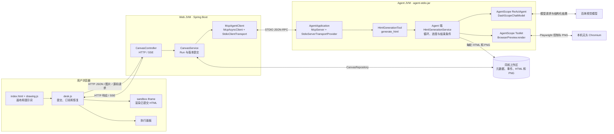
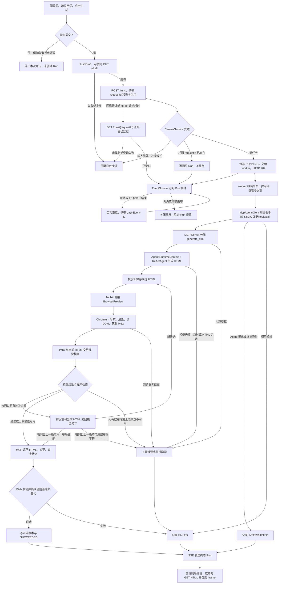
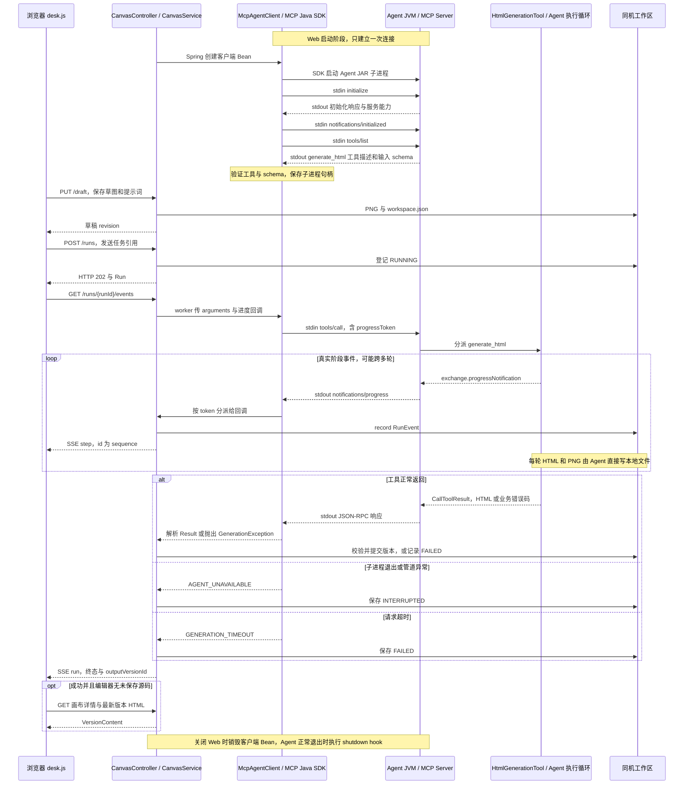
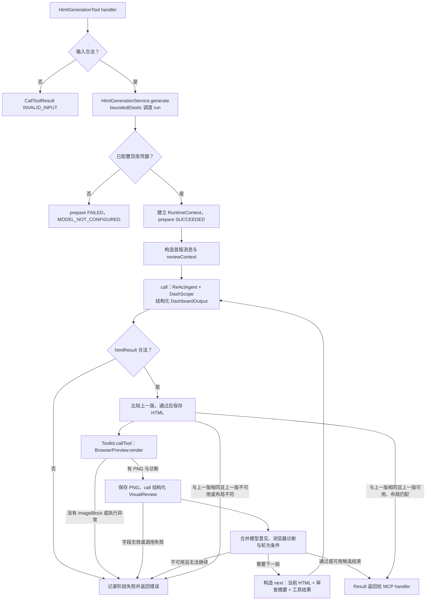
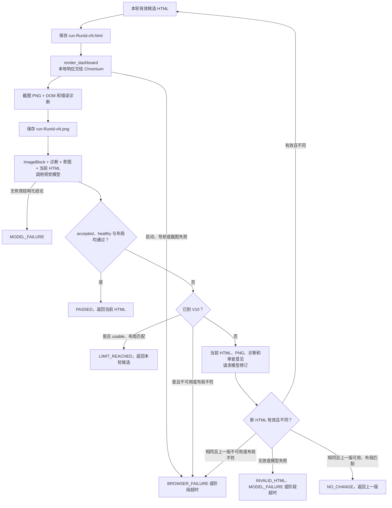
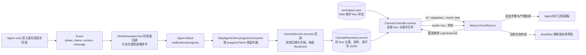
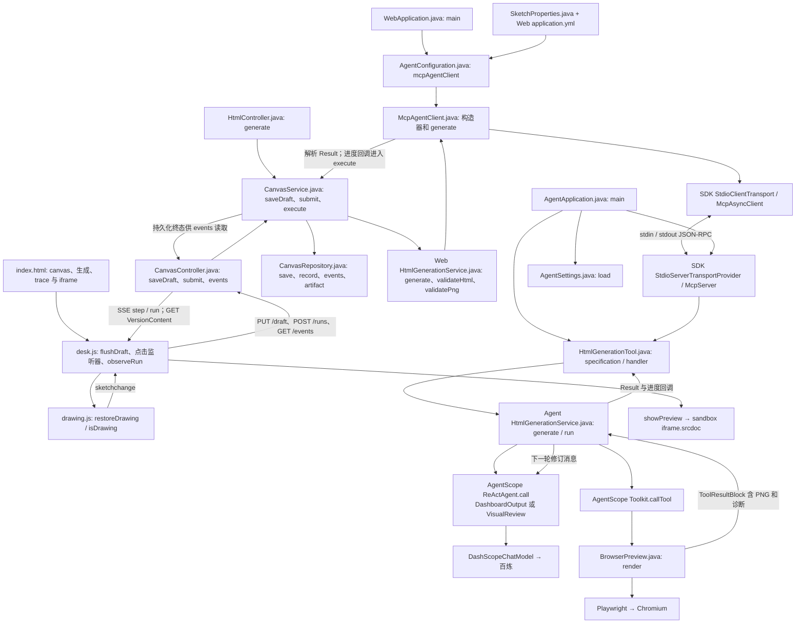

# UI 生成 Agent 源码运行手册

> 本文保留原 STDIO 架构的执行链路和验收记录，不代表当前首页实现。文中的 `desk.js`、`desk.css`、`drawing.js` 已移除；当前组件编辑器使用 `component-editor.js` 和 `component-editor.css`。现有 Agent/MCP 能力仍保留，当前架构由业务端提供 MCP 服务，Agent 侧调用业务工具，见 [README 的执行链路](../README.md#执行链路)。

本文从当时的源码还原一次生成任务。主线采用工作台的异步提交入口。两条同步兼容入口另行标出。文件路径相对项目根目录，MCP SDK 与 AgentScope 的类名标注为外部依赖。原验收记录用于印证已发生的行为，本次分析未重新提交生成任务。

## 1. 实际架构

浏览器只连接 Web 应用。Web JVM 在启动时建立一条到 Agent JVM 的 STDIO 连接，后续画布共享这个连接和 Agent 实例。Agent JVM 调用百炼，并按轮启动无头 Chromium。两个 JVM 使用同一个本地工作区目录，但分别写不同文件。

### 同一张画布上的标识

| 标识 | 生成位置 | 实际作用 |
| --- | --- | --- |
| `canvasId` | `CanvasService.create()` | HTTP 路由中的画布 ID，也是工作区子目录名。 |
| `sessionId` | 同一次 `create()`，独立 UUID | 持久化于 `workspace.json`。每个 Run 将其传给 AgentScope `RuntimeContext`，Web 也用它校验进度归属。 |
| `requestId` / `runId` | `desk.js` 中 `crypto.randomUUID()` | 同一个值。Web 用它作为 `Run.id`，并在同一画布内判重。 |
| `progressToken` | `McpAgentClient.generate()`，每次 STDIO 调用生成 | 路由进行中的 MCP 进度通知。它与 Run ID、MCP 协议会话以及 JSON-RPC 请求 ID 分开。 |
| 轮次 `version` | Agent 循环，`1..10` | 只在当前 Run 内有效，决定轮次文件名和面板的 V1、V2 等标记。 |
| `Version.id` / `Version.number` | `CanvasService.addVersion()` | 画布历史中已提交的版本 UUID 和序号。一次 Run 可以渲染十版，正常只提交一个画布版本。 |

## 2. 从点击生成到最终预览

### 2.1 按真实顺序跟踪 18 步

| 步骤 | 发起者与代码入口 | 输入、操作、输出及下一站 |
| --- | --- | --- |
| 1. 点击生成 | 用户 → `desk.js` 的 `generate` 点击监听器 | 检查画布、是否已有 Run、是否正在画图、未保存源码是否允许丢弃。生成 `requestId`，置本地 `running`，先 `await flushDraft(state)`。草稿已经保存时无需再发 PUT。 |
| 2. 接收草图与提示词 | `drawing.js.notifySketch()`、`desk.js.flushDraft()` → `CanvasController.saveDraft()` | 草图由 Canvas 导出为 PNG Base64，`sketchchange` 交给工作台。提示词输入和草图变化都触发 320ms 防抖保存。PUT `/api/canvases/{id}/draft` 发送 `DraftInput(revision, replaceSketch, sketchBase64, prompt)`。Web 检查草稿版本、文本、PNG 格式及尺寸，按图片 SHA-256 写文件，保存提示词并返回新版 `Draft`。 |
| 3. Web 发起任务调用 | `desk.js` → `CanvasController.submit()` → `CanvasService.submit()` | POST `/api/canvases/{id}/runs` 传 `GenerateInput` 的请求 ID、草稿版本和可选版本/反馈引用。Web 持久化 `RUNNING` 后交给单线程 worker，并返回 202 和 Run。worker 的 `execute()` 读工作区、组装参数，经 Web 端 `HtmlGenerationService.generate()` 转给 `McpAgentClient.generate()`。前端收到 Run 后开 SSE。 |
| 4. 使用已连接的 STDIO | Spring 启动 → `AgentConfiguration.mcpAgentClient()` → `McpAgentClient` 构造器 | **这一步在首次点击前已执行。** SDK 启动 Java 子进程，通过管道初始化并执行 `tools/list`。每个 Run 在已有连接上发一个 `tools/call`，携带参数与独立 `progressToken`。 |
| 5. Agent 接收工具调用 | `AgentApplication.main()` 注册的 `HtmlGenerationTool.specification()` handler | `StdioServerTransportProvider` 从 stdin 收到 JSON-RPC；SDK 按工具名分派。handler 读取参数，校验 UUID、模式、类型、长度、create/revise 必需字段。非法参数返回 `isError=true` 与 `INVALID_INPUT`，合法参数变成 Agent 端 `Request`。 |
| 6. 进入执行 | `HtmlGenerationTool` → Agent 端 `HtmlGenerationService.generate()` / `run()` | handler 提供进度回调。服务通过 `Mono.fromCallable(...).subscribeOn(Schedulers.boundedElastic())` 执行任务，建立 `RuntimeContext(userId, sessionId, runId)`，准备消息和审查参考，进入最多 10 版的 Java 循环。 |
| 7. 模型理解草图 | `run()` → `call(next, DashboardOutput.class, context)` → `ReActAgent.call()` | AgentScope 发送包含 `TextBlock`、可选 PNG `ImageBlock` 的 USER 消息，连同系统提示交给 `DashScopeChatModel`。理解布局和文字要求发生在同一次生成调用内，没有单独的 OCR 或草图解析服务。 |
| 8. 生成并验收 HTML 格式 | 百炼 → AgentScope `Msg` → `htmlResult()` | 读取结构化 `html` 和 `designBrief`。校验完整文档和大小，去围栏、补 DOCTYPE，只有 create 的 V1 可以把合规 `main` 片段包装为完整文档。有效候选先写该轮 HTML 文件，再发生成成功步骤。 |
| 9. 调用浏览器 | Agent 端 `run()` → `Toolkit.callTool()` → `BrowserPreview.render()` | 应用代码构造名为 `render_dashboard` 的 `ToolUseBlock`，传 `html` 参数的 Map 与 JSON，以及同一 RuntimeContext。Toolkit 调用 `@Tool` 注册方法，程序等待 `ToolResultBlock`。 |
| 10. 加载页面 | `BrowserPreview.render()` → Playwright Chromium | 每轮建 Chromium、Context 和 Page。注册 `context.route`，再 `page.navigate` 到 `https://dashboard.invalid/`。Playwright 把当前 HTML 作为 200 响应在本地提供，等待 LOAD。占位域名没有对应的 Web 路由。 |
| 11. 取截图 | `BrowserPreview.render()` → `page.evaluate()` / `page.screenshot()` | 读取 DOM、文档尺寸和错误信息，截取 `1280×800` 视口。工具返回 PNG `ImageBlock`、诊断 `TextBlock` 以及 `usable/healthy/diagnostics` 元数据。Agent 服务把同一 PNG 解码写盘，再发渲染成功步骤。 |
| 12. 送视觉模型 | Agent 端 `run()` → `call(review, VisualReview.class, context)` | 审查消息组合适用的草图、提示词、摘要与反馈、本轮候选 HTML、工具的 PNG 和 DOM 诊断。工具返回的 `ImageBlock` 直接追加到模型消息，PNG 不经过 Web 或 SSE 回传给模型。 |
| 13. 模型审查 | 百炼 → AgentScope `Msg` → `VisualReview(accepted, summary)` | 模型对照布局、内容、可读性、重叠和溢出。Agent 校验两个字段并将摘要限制在 400 个 Unicode 码点。模型的验收意见会进入执行面板。 |
| 14. 决定修订内容 | Agent 端 `run()` | 若未通过且有轮次余额，程序保留当前候选和可用性，将最新 HTML、PNG、DOM 诊断与审查摘要放进 `next`，要求保留其余设计和内容。下一次模型调用返回完整修订 HTML，不生成或应用 diff。 |
| 15. 重新预览 | 同一个 `for` 循环的下一轮 | 校验修订后的 HTML。若和上一候选不同，先保存 HTML，重新调用浏览器，生成新的 PNG，再用新截图独立审查。 |
| 16. 决定结束 | Agent 端 `run()` 的显式条件 | `accepted && healthy` 且适用的布局校验通过 得 `PASSED`；V10 仍未通过但布局校验通过且当前可展示得 `LIMIT_REACHED`；修订与上一版完全相同且上一版可展示得 `NO_CHANGE`。无法展示或执行错误走失败分支。 |
| 17. 最终 HTML 返回并提交 | `HtmlGenerationTool` → STDIO → `McpAgentClient` → `CanvasService.execute()` | MCP 成功响应的 `content[0]` 是 HTML 文本，`structuredContent` 放设计摘要和审查状态。Web 验证响应与 HTML 格式，提交前重新检查当前画布版本，写正式 HTML 文件和 Version，将 Run 更新为终态。 |
| 18. 浏览器显示 | `CanvasController.events()` → `desk.js.observeRun()` → `showRun()` / `reloadResult()` | 前端收到终态 `run` 事件后刷新画布详情，成功且源码编辑器没有未保存内容时，再 GET 最新 `VersionContent`。设置源码编辑器，切换预览并写入 iframe `srcdoc`。原有未保存源码会保留，失败时展示原因。 |

实际有两次主要 HTTP 写入，先 PUT 保存图与提示词，再 POST 提交引用。草稿已自动保存时，点击后可能只看见 POST。`replaceSketch=false` 保留草图，`true + null` 清除，`true + Base64` 替换。相同草图与提示词不会增加草稿版本。默认每张输入图片限 1 MiB，草图最大边 1024px，手动上传的反馈截图最大边 4096px，HTML 限 131072 UTF-8 字节。PNG 校验由 Web 端 `HtmlGenerationService` 使用 ImageIO 实际解码完成。

`CanvasService.generate(..., background)` 在同步区先按请求 ID 判重，再核对 `expectedVersionId` 与 `draftRevision`，选择当前版本或指定旧版本作为基准，检查是否有新草图、修改文字或反馈。单槽 `Semaphore.tryAcquire()` 忙时直接返回 `GENERATION_BUSY`，没有等待队列。Run 持有提交时的提示词和不可变资源引用。执行期间可以继续编辑画布，任务的输入不会随草稿变化。若期间有人提交了一个正式 HTML 版本，最终 `checkCurrent()` 会拒绝覆盖。

`modelInput()` 总是发送 `canvasId/sessionId/runId/mode/prompt`。它从文件读取草图，并按是否新附带选择 `imageBase64` 或 `referenceSketchBase64`。存在基准版本时补上 `baseHtml/designBrief`；选了反馈时补上含来源版本号的 `feedback`，有反馈图再附 `screenshotBase64`。最后一项是**用户上传的反馈图**，而每轮浏览器自动截图发生在 Agent 侧。

结果展示时，`showPreview()` 保留自己的 HTML 字符串，在原 DOCTYPE 位置插入 DOCTYPE 和 CSP meta，经过两个 `requestAnimationFrame()` 后给 `<iframe sandbox referrerpolicy="no-referrer">` 设置 `srcdoc`。这是浏览器对正式 HTML 的一次独立渲染。工作台刷新后直接读取当前正式版本，执行面板则通过 Run 单独恢复。若任务刚结束又有人保存了更新的正式版本，`reloadResult()` 实际读取刷新后最新版本的 ID，`outputVersionId` 在这里用作是否加载结果的条件。

### 2.2 端到端流程图

图中的“查是否已登记”只在 POST 抛出的错误没有 HTTP 状态时进行，源码没有自动重新 POST。相同 `requestId` 的重复请求返回原记录，包括失败终态。用户重新点击会产生新的 UUID。当前没有取消 Run 的按钮、HTTP 路由或 `CANCELLED` 终态。SSE 断开和页面关闭只影响观察端。

兼容入口 `POST /api/canvases/{id}/generate` 读取同一个 `GenerateInput`，调用同步的 `CanvasService.generate()` 后返回 Run。更早的 `POST /api/html/generate` 接收原始 `image/png`，`generateLegacy()` 创建画布、保存图像并同步调用同一个执行流程，最终返回 `HtmlResponse(html)`。工作台按钮使用 `POST /runs`。

## 3. MCP STDIO 的两个进程

### 3.1 启动、握手与收发

1. `WebApplication.main()` 启动 Spring Boot。Spring 创建 `AgentConfiguration.mcpAgentClient()` Bean，构造器要求 Web JVM 默认字符集为 UTF-8，并检查 Agent JAR 存在且可读。JAR 默认是 `agent-stdio/target/agent-stdio.jar`，依次接受 `SKETCH_AGENT_JAR`、`DEMO_AGENT_JAR` 覆盖。
2. 构造器从 Web 的 `java.home/bin` 解析 `java` 或 `java.exe`，配置子进程命令 `<java> -Dfile.encoding=UTF-8 -jar <Agent JAR 绝对路径>`。额外设置 `SKETCH_RUN_ARTIFACT_ROOT` 为 Web 数据目录的绝对规范化路径。百炼凭据由子进程从继承的环境变量读取。Web 源码创建 `StdioClientTransport`，实际 `ProcessBuilder.start()` 在 MCP Java SDK 0.17.2 内。
3. 调用 `client.initialize().block(startupTimeout)`。由 SDK 发送 `initialize`，包含协议版本、客户端能力和身份。Agent 返回协商版本、服务能力和身份，SDK 再发送 `notifications/initialized`。原验收日志协商结果是 `2024-11-05`，Server 自报 `sketch-agent / 0.1.0`。协议版本与 Maven 依赖版本是不同字段。 [MCP 初始化生命周期](https://modelcontextprotocol.io/specification/2024-11-05/basic/lifecycle)
4. 握手后，项目主动 `client.listTools()`，检查有 `generate_html` 且 schema 至少含 `canvasId/sessionId/runId/mode/prompt/baseHtml`，再从启动前后新增的直接子进程中取得唯一 `ProcessHandle`。初始化与工具发现分别用默认 10 秒等待上限。失败时关闭客户端并抛出启动异常。
5. SDK 把 JSON-RPC 消息按行写到 Agent stdin，读取 Agent stdout。工具结果和进度通知共用 stdout。Agent 入口先保存原 `System.out` 给 `StdioServerTransportProvider`，把普通 `System.out` 重定向到 stderr，防止日志破坏协议。Web 侧 SDK 另外读取子进程 stderr。 [MCP STDIO 传输](https://modelcontextprotocol.io/specification/2024-11-05/basic/transports)
6. `McpAgentClient.generate()` 先注册 `listeners[token]`，再用 `new CallToolRequest("generate_html", arguments, Map.of("progressToken", token))` 发送请求。SDK 的请求 ID 对应最终响应。进度通过 `notifications/progress` 返回，由 `progressToken` 匹配本次 Web 回调。两类消息分别处理。 [MCP 进度通知](https://modelcontextprotocol.io/specification/2025-06-18/basic/utilities/progress)
7. Agent handler 通过 `exchange.progressNotification()` 发送中间步骤，通过工具 handler 的返回值发送最终结果。成功结果含一项 `TextContent(html)` 和 `structuredContent{designBrief, reviewStatus}`，工具错误含一项错误码文本及 `isError=true`。Web 映射这些结果为 Java `Result` 或 `GenerationException`。JSON-RPC/管道异常与工具返回的业务错误走不同处理路径。

### 3.2 时序图

图中 HTTP 202、后台 STDIO 调用与 SSE 订阅可以并行先后发生。落盘让订阅较晚的浏览器仍能看到已经发生的步骤。这个 SSE 接口是 Web 的业务事件接口，浏览器没有连接 MCP。

### 3.3 反向调用、断开和关闭

- **Agent 调用 Web 业务能力。** 当前没有这条 RPC 路径。Web 客户端只配置进度消费，没有为 Agent 注册 sampling、elicitation 或业务回调。Agent 发进度属于单向通知，写轮次产物走共享文件系统。Agent 调百炼和 Playwright 也是它自己的调用。SDK 的双向协议能力与项目已接线的能力需分别理解。
- **连接异常。** 调用通过 `Mono.firstWithSignal()` 竞争工具响应和 `process.onExit()`，另套默认 35 分钟超时。Agent 子进程退出或其它非超时连接错误转为 `AGENT_UNAVAILABLE`，`CanvasService.execute()` 写 `INTERRUPTED`。超时写 `FAILED / GENERATION_TIMEOUT`。客户端在 `finally` 移除进度 listener。应用层没有确认超时后 Agent 远端工作一定已停止，也没有自动重建子进程。
- **服务关闭。** Web 的 `CanvasService.stopWorker()` 调 `shutdownNow()`，Bean 销毁时 `McpAgentClient.close()` 委托 SDK 关闭连接。Agent 正常进入 JVM shutdown hook 时关闭 MCP Server，再关闭 ReActAgent。若 Web 异常退出导致 Run 仍为 `RUNNING`，下次 `CanvasService` 初始化扫描工作区，标记 `INTERRUPTED / restart`。已落盘步骤与轮次保留，本次 Run 不续跑。重启 Web 会创建新的 Agent 连接。

## 4. Agent 内部与 Session

### 4.1 Session 和任务内状态各存在哪里

`CanvasService.create()` 把 `sessionId` 写到画布元数据。每次 `CanvasService.modelInput()` 把它与新的 Run ID 送到 Agent。Agent 在 `run()` 用固定 `userId="sketch-workspace"`、这两个 ID 构造 RuntimeContext，所有模型调用及 Toolkit 调用复用该上下文。Agent 端 service 是启动时创建的共享实例，`call()` 每次结束都会在 `finally` 调用 `agent.clearStateCache(context)`。

本轮循环由 Java 局部变量 `version`、`next`、`previous`、`previousUsable` 管理。跨 Run 依靠 Web 重新传入已保存的基准 HTML、设计摘要、草图引用和可选用户反馈。应用没有配置可用于重启后恢复聊天上下文的 AgentScope 状态存储，也没有把旧轮次或整段对话自动重新加载到模型。

### 4.2 输入与结构化输出

首版消息包含 create/revise 指令、最新提示词，以及适用的草图、已有版本摘要、基准 HTML 和用户选择的反馈。若没有重新附草图，但已选版本有 `sketchId`，Web 传 `referenceSketchBase64`，Agent 默认将这张图放入审查和后续修订使用的 `reviewContext`。普通文字修订时旧草图只作为审查参考。若提示词或反馈触发按原草图重新排版，Agent 会在首版附上原草图，并跳过旧 HTML 和旧摘要，以免沿用已经偏离的结构。审查与迭代修订使用当前候选 HTML。

配置从 Agent JAR 的 `application.yml` 或 `AGENT_CONFIG_FILE` 加载。模型由 `DashScopeChatModel.builder()` 创建，默认 `qwen3.6-flash`，可用 `DASHSCOPE_MODEL` 和 `DASHSCOPE_BASE_URL` 覆盖，配置 `stream(false)`。未开启 thinking 时，ReActAgent 配置 `ToolChoice.Specific(ReActAgent.STRUCTURED_OUTPUT_TOOL_NAME)`，明确请求框架的结构化输出工具。生成和修订读取 `DashboardOutput(html, designBrief)`，视觉审查读取 `VisualReview(accepted, summary)`。`call()` 每次构造一个 USER `Msg`，用框架的带输出类型重载执行，应用层默认每次等待最多 65 秒。

| 决策 | 模型负责 | 应用代码负责 |
| --- | --- | --- |
| 如何理解草图与设计要求 | 识别布局与内容意图，产出候选或修订 HTML。 | 决定传哪些图、哪版 HTML 与哪些提示词，并校验结构化输出和 HTML 格式。 |
| 何时开浏览器 | 模型不参与这一步。 | 每个有效且与前版不同的候选都由 Java 主动调用 Toolkit。 |
| 画面是否符合要求 | 根据截图、HTML、要求和诊断给出 `accepted` 与理由。 | 检查 `healthy`，合并模型结论，决定通过、修订、保留候选或失败。 |
| 修订范围与结束 | 根据审查意见生成完整修订文档。 | 明确附带当前候选与反馈，计数、比较相同 HTML、管理超时及产物，并决定结束。 |

## 5. 浏览器反馈与 HTML 迭代

### 5.1 `BrowserPreview.render()` 的实际操作

1. 创建 Playwright，设置 `PLAYWRIGHT_SKIP_BROWSER_DOWNLOAD=1`。运行时依赖预装的 Chromium。启动 Chromium 时启用 Chromium sandbox，设置 15 秒启动超时。每次调用创建一个 Context，禁用网页 JavaScript 和下载，视口 `1280×800`。try-with-resources 在调用退出时关闭 Context、Browser 和 Playwright。
2. 在 Page 上注册 `onConsoleMessage` 和 `onPageError`。只收 console 的 error 级消息，最多保存 5 条，每条最多 240 字符。随后在 Context 注册 `route("**/*", ...)`。仅当请求匹配占位 URL、属于导航请求且页面仍为 `about:blank` 时，`route.fulfill()` 返回当前 HTML。其它被拦截的请求执行 `abort()`。
3. 合成响应为 HTTP 200、`text/html; charset=utf-8`，带 CSP `default-src 'none'; style-src 'unsafe-inline'; base-uri 'none'; form-action 'none'; sandbox`。调用 `page.navigate()`，等待 `WaitUntilState.LOAD`，上限 10 秒。这个 URL 只用来触发导航和本地响应拦截。
4. `page.evaluate()` 是 Playwright 主动执行的诊断代码，读取 `readyState`、标题前 120 字符、`body.innerText` 前 400 字符、是否有满足几何和样式条件的视口内元素，以及 `scrollWidth/scrollHeight`。网页自己的脚本仍禁用。然后 `page.screenshot()` 在最多 10 秒内取默认视口 PNG，没有全页截图、滚动或点击。
5. `usable` 要求导航响应成功、URL 匹配、`readyState=complete`、至少一个满足可见性检测的元素且正文文本非空。 `healthy` 额外要求文档宽不超过 1280、已采集错误列表为空。文档高度会提供给模型，**高度超出视口没有独立的硬性失败判定**。可见性检查是启发式，无法逐项证明所有组件都可见。
6. 工具构造 `ToolResultBlock`。第一个输出是使用 Base64 PNG 的 `ImageBlock`，第二个是含诊断、DOM 文本和错误摘要的 `TextBlock`。元数据有 `usable`、`healthy` 和简短 `diagnostics`。工具返回截图即可发 `render / SUCCEEDED`，即使截图显示溢出。页面质量在后续审查步骤独立判断。

### 5.2 截图如何进入下一轮

修订阶段的 `ImageBlock` 和诊断来自刚被审查的同一轮，模型输出新候选后才会重新运行浏览器。没有“失败后自动回滚到任意较早的最好版本”的搜索。V10 的兜底要求 V10 可展示且通过适用的布局校验，`NO_CHANGE` 只看直接上一版。模型返回无效 HTML、无有效审查意见或浏览器工具失败时会结束，本项目没有包一层自动重试该阶段的策略。这里的多轮是根据审查修订内容，SDK 或模型内部行为另属依赖层。

对可识别的闭合矩形草图，`SketchLayout.detect()` 从原 PNG 提取区域，归一化后把坐标和 `data-sketch-region` 编号交给模型。Chromium 返回带编号的 DOM 区域实测边界，`SketchLayout.mismatch()` 检查区域是否缺失、重复、未完整出现在首屏，或位置和比例偏差过大。即使模型返回通过，实测布局不符也会触发修订。达到上限或修订内容重复时，布局仍不符会返回 `LAYOUT_MISMATCH`，保留轮次文件，Web 不提交该候选。未检测到明确矩形布局的草图继续使用图像审查。

### 5.3 文件如何落盘

| 文件名，均位于 `<dataDirectory>/<canvasId>/` | 写入者 | 写入时机及用途 |
| --- | --- | --- |
| `workspace.json` | Web 的 `CanvasRepository.save()` | 保存画布、Session、Draft、Version、Feedback 与 Run。登记和完成各更新一次 Run。 |
| `sketch-<sha256>.png` | Web 的 `CanvasService.saveDraft()` | 草稿保存时写入，运行中按已选 sketchId 读取。 |
| `screenshot-<sha256>.png` | Web 的 `CanvasService.addFeedback()` | 用户手动上传的反馈截图，仅当任务选了这条反馈时传给 Agent。 |
| `run-<runId>-v<N>.html` | Agent 的 `saveArtifact()` | 该轮候选通过格式检查后、调用浏览器前写入。浏览器失败时可能只有 HTML。 |
| `run-<runId>-v<N>.png` | Agent 的 `saveArtifact()` | 收到工具 PNG 后、开始模型审查前写入。两种轮次文件使用临时文件与原子移动。直接调用 MCP 时缺共享目录或画布 ID 会跳过落盘。 |
| `run-<runId>-events.json` | Web 的 `CanvasRepository.record()` | Agent 进度到达时保存排序后的事件 JSON 数组。 |
| `<versionId>.html` | Web 的 `CanvasService.addVersion()` | 生成结果通过 Web 校验并满足基准一致性后，或手动保存源码时写入。此文件是最终 iframe 和版本详情读取的 HTML。 |

Web 的文件写入走 `CanvasRepository.atomicWrite()`，临时文件写完并 `force(true)` 后原子替换。HTML 与 `workspace.json` 是两次文件操作，源码没有跨文件事务，写完 HTML 后若元数据保存失败可能留下未被引用的文件。

## 6. 执行事件从 Agent 到页面

### 6.1 何时发事件，事件包含什么

`HtmlGenerationService.run()` 在真实动作前后显式调用 `progress.accept(new Event(...))`。这不是模型 token 流、工具 stdout 或私有推理记录。一次新建工作台 Run 中，Agent 可能发出以下步骤。

| phase | 发出位置和含义 |
| --- | --- |
| `prepare` | 检查模型凭据后发 `SUCCEEDED` 或 `FAILED`，此时 `version=0`。 |
| `generate` | V1 调用模型前发 `RUNNING`，有效 HTML 落盘后发 `SUCCEEDED`，格式错误等走 `FAILED`。即使整个 Run 是 revise 模式，V1 的 phase 仍是 generate。 |
| `revise` | V2 至 V10 使用上一轮反馈调用模型，发出相应开始、完成或失败。相同 HTML 会产生 `revise / FAILED` 步骤，但上一版可用时 Run 可带 `NO_CHANGE` 成功结束。 |
| `render` | Toolkit 调用前发 `RUNNING`，确认 PNG 并落盘后发 `SUCCEEDED` 与诊断摘要，工具失败发 `FAILED`。 |
| `review` | 发送截图给模型前发 `RUNNING`，按有效结论与浏览器诊断发 `SUCCEEDED`、`NEEDS_REVISION` 或 `FAILED`。 |
| `limit` | 到 V10 仍未通过时发 `NEEDS_REVISION` 或 `FAILED`，并说明是否保留候选。 |

一条记录经过三次表示转换。

1. **Agent 本地** `Event(phase, status, version, message)`。
2. **STDIO** `ProgressNotification(progressToken, progress, total, message, meta)`。handler 的 `AtomicInteger` 从 1 开始递增，`progress` 表示序号，`total=null`。元数据含 `phase/status/version/sessionId/runId`。有合法 token 才通知，每次调用 `exchange.progressNotification(...).block(Duration.ofSeconds(5))`。这一步等待 SDK 的发送操作，没有 Web 已持久化的应用层确认。
3. **Web 落盘与 SSE** `RunEvent(canvasId, sessionId, runId, sequence, receivedAt, phase, status, version, message)`。画布 ID 取自当前调用上下文，`receivedAt` 是 Web 接收时间。回调校验 Run、Session、正整数序号、必要字段类型和消息长度。回调异常会被 `McpAgentClient` 记录，若工具调用随后正常返回，Web 会以 `STORAGE_FAILURE` 结束任务。

终态 `run` 由 Web 根据已持久化的 `Run` 产生。它不占 Agent 步骤序号。比如 Agent 发出 `review / SUCCEEDED` 后，Web 仍可能因为画布版本冲突拒绝提交，最终发送 `FAILED`。

### 6.2 顺序、持久化和补读

- **持久化顺序。** `CanvasRepository.record()` 同步读该 Run 的 JSON 数组，按 `sequence` 去重与排序，然后原子替换文件。它重写一个短数组，不是追加日志或内存消息队列。
- **推送方式。** `CanvasController.events()` 先确认 Run 存在，返回 `StreamingResponseBody`，设置 `text/event-stream`，发送连接注释。流在最多 20 秒的窗口内每约 300ms 读一次 Run 与事件文件，把序号大于游标的步骤写成 `id: <sequence>`、`event: step`、`data: <RunEvent JSON>`，并显式调用 `response.flushBuffer()`。因此前端接到的是服务器推送，服务器内部通过轮询已落盘数据发现更新。
- **序号缺口。** `RUNNING` 时必须看到下一个连续序号，遇缺口就等下次读。终态时会发送剩余可读的步骤，即使中间有缺号，最后写 `event: run` 和终态 Run JSON 并关闭本次流。实现没有丢失事件的补写机制。
- **当前页面重连。** 超过 20 秒仍未完成，服务端结束该次流。网络中断也可能结束流。仍打开的 `EventSource` 自动重连，发送最后接收的 `Last-Event-ID`。服务端据此跳过已读序号。前端断线时更新提示，连接恢复后恢复最近的阶段标签。
- **刷新页面。** `desk.js.start()` 根据 URL 的 `canvas` 参数或画布列表找画布。`switchCanvas()` 重新 GET 画布详情、最新正式 HTML 与草图，挑选运行中的 Run，否则挑最近一条。它新建 EventSource、清空本地列表，通常从 0 重放。手动选择历史 Run 也走 `observeRun()`。浏览器没有把序号存到本地持久化。
- **渲染执行面板。** `observeRun()` 的 `step` 回调按到达顺序追加 `li`，用 `textContent` 写序号、轮次、标签与诊断。生成/修订成功加源码链接，渲染成功加截图链接。当前 Run 的 `run` 回调关流并调用 `showRun()`；选择历史 Run 时只回放其记录。

### 6.3 三条不同的数据链

| 展示或消费对象 | 传输 | 浏览器看到什么 |
| --- | --- | --- |
| Agent 执行事件 | Agent → STDIO progress → Web 落盘 → SSE | 状态、诊断和审查摘要。无图片字节。 |
| 轮次截图 | Agent 内部 PNG 转 `ImageBlock` 送模型，同时 PNG 写文件；前端按需 GET `/runs/{runId}/rounds/{version}/image` | Chromium 在某一轮截取的一张静态 PNG。手工反馈截图另走 `/feedback/{feedbackId}/image`。 |
| 最终页面 | MCP 响应返回 HTML，Web 保存正式版本；前端 GET `/versions/{versionId}` | 浏览器自己的 sandbox iframe 渲染 HTML。前端 iframe 尺寸由工作台布局决定，可能与 Agent 的固定视口不同。 |
| 浏览器实时操作画面 | 未实现。项目没有帧采集或视频传输入口。 | 当前没有直播画面。README 的 CDP/WebSocket 内容是技术方案。 |

## 7. 源码文件职责清单

“新增”指上一轮浏览器反馈与执行过程功能引入的文件。“已有”表示当时是在该文件上沿用或扩展。本目录没有可用于本次核对的 Git 历史，此分类依据上一轮实施前后的文件清单。方法名对应当前文件。

### 7.1 Agent 模块

| 文件路径 | 所属模块 | 主要职责 | 核心方法 | 被谁调用 | 调用了谁 |
| ---- | ---- | ---- | ---- | ---- | ---- |
| [agent-stdio/pom.xml](../agent-stdio/pom.xml) | Agent，已有 | 声明 MCP、AgentScope、百炼扩展、Playwright 1.45.0、YAML 和日志依赖。 | Shade 插件生成 `agent-stdio.jar`，Manifest 指向 `AgentApplication`。 | Maven | 根 POM、依赖及打包插件 |
| [agent-stdio/src/main/resources/application.yml](../agent-stdio/src/main/resources/application.yml) | Agent，已有 | Server 身份、模型、超时、输入限制和默认生成提示词。 | 默认 `qwen3.6-flash`、65 秒、关闭 thinking。 | `AgentSettings.load()` | 无 |
| [agent-stdio/src/main/java/demo/hb/agent/AgentApplication.java](../agent-stdio/src/main/java/demo/hb/agent/AgentApplication.java) | Agent，已有 | Agent JVM 启动、STDIO Server 接线与退出。 | `main()` 保留协议输出、注册工具、安装 shutdown hook。 | 子进程 JVM / JAR Manifest | `AgentSettings`、SDK `StdioServerTransportProvider/McpServer`、`HtmlGenerationTool`、Agent service |
| [agent-stdio/src/main/java/demo/hb/agent/config/AgentSettings.java](../agent-stdio/src/main/java/demo/hb/agent/config/AgentSettings.java) | Agent，已有 | 配置读取、校验和环境覆盖。 | `load()` 读内置或外置 YAML；`apiKey()`、`configuredModel()`、`configuredBaseUrl()` 读取环境；`maxBase64Length()` 计算编码上限。 | `AgentApplication`、Agent service | YAMLMapper、文件、环境变量 |
| [agent-stdio/src/main/java/demo/hb/agent/mcp/HtmlGenerationTool.java](../agent-stdio/src/main/java/demo/hb/agent/mcp/HtmlGenerationTool.java) | Agent，已有 | MCP 协议和执行服务之间的适配。 | `specification()` 定义 schema，校验输入，创建 `Request`，将步骤包装为 ProgressNotification，将结果包装为 CallToolResult。 | `AgentApplication` 注册、SDK 分派 | Agent service、MCP exchange |
| [agent-stdio/src/main/java/demo/hb/agent/service/HtmlGenerationService.java](../agent-stdio/src/main/java/demo/hb/agent/service/HtmlGenerationService.java) | Agent，已有 | 多模态请求、HTML 生成与校验、工具执行、视觉迭代、步骤与产物。 | 构造器建 ReActAgent 并注册浏览器工具；`generate()/run()` 调度与循环；`call()` 发送结构化模型请求并清状态缓存；`htmlResult()` 校验 HTML；`saveArtifact()` 写轮次文件。 | `AgentApplication`、`HtmlGenerationTool` | AgentScope RuntimeContext、ReActAgent、Toolkit、百炼模型、文件系统、进度回调 |
| [agent-stdio/src/main/java/demo/hb/agent/service/BrowserPreview.java](../agent-stdio/src/main/java/demo/hb/agent/service/BrowserPreview.java) | Agent，新增 | 本机浏览器管理、页面加载、诊断和截图。 | `render()` 启动 Chromium、拦截加载、等待、读取 DOM、返回图片与诊断；`record()` 限制错误摘要。 | Agent service 注册，由 Toolkit 执行 | Playwright、Chromium、AgentScope 消息类型 |
| [agent-stdio/src/main/java/demo/hb/agent/service/SketchLayout.java](../agent-stdio/src/main/java/demo/hb/agent/service/SketchLayout.java) | Agent，布局修复新增 | 识别闭合矩形区块并验证浏览器中的实际排布。 | `detect()` 读取原草图 PNG 并提取区域，`instruction()` 生成坐标要求，`mismatch()` 检查实测区域。 | Agent 端 `HtmlGenerationService.run()` | ImageIO，浏览器工具返回的区域元数据 |

### 7.2 Web 启动、业务、存储与协议

| 文件路径 | 所属模块 | 主要职责 | 核心方法 | 被谁调用 | 调用了谁 |
| ---- | ---- | ---- | ---- | ---- | ---- |
| [pom.xml](../pom.xml) | 根项目，已有 | Maven 聚合与依赖版本管理。 | modules、JDK 17、Spring Boot 4.1.2、AgentScope 2.1.0-BETA1、MCP SDK 0.17.2。 | Maven | 两模块 POM |
| [web-app/pom.xml](../web-app/pom.xml) | Web，已有 | Spring MVC 和 MCP Java SDK 依赖，打包 Web JAR。 | Spring Boot `repackage`。 | Maven | 根 POM、依赖及打包插件 |
| [web-app/src/main/resources/application.yml](../web-app/src/main/resources/application.yml) | Web，已有 | 默认监听地址、Agent 路径、启动和请求超时、数据路径与校验上限。 | `127.0.0.1:8080`、10 秒初始化、35 分钟调用、`./sketch-data`。 | Spring Boot | `SketchProperties` 接收绑定值 |
| [web-app/src/main/java/demo/hb/web/WebApplication.java](../web-app/src/main/java/demo/hb/web/WebApplication.java) | Web，已有 | Web JVM 入口。 | `main()` 调用 `SpringApplication.run()`。 | JVM / Boot JAR | Spring 容器 |
| [web-app/src/main/java/demo/hb/web/config/AgentConfiguration.java](../web-app/src/main/java/demo/hb/web/config/AgentConfiguration.java) | Web，已有 | 注册配置和 MCP 客户端 Bean。 | `mcpAgentClient()` 创建客户端，Bean 销毁时调用 `close()`。 | Spring 容器 | `SketchProperties`、`McpAgentClient` |
| [web-app/src/main/java/demo/hb/web/config/SketchProperties.java](../web-app/src/main/java/demo/hb/web/config/SketchProperties.java) | Web，已有 | `sketch.*` 的类型化绑定。 | record `Agent` 持路径与超时，`Generation` 持大小限制。 | Spring 绑定、Controller、service、repository | 无业务 I/O |
| [web-app/src/main/java/demo/hb/web/mcp/McpAgentClient.java](../web-app/src/main/java/demo/hb/web/mcp/McpAgentClient.java) | Web，已有 | 启动、识别 Agent 子进程并管理 STDIO 客户端。 | 构造器握手及发现工具；`generate()` 管理 token、超时、进程退出和结果解码；`close()` 委托 SDK。 | `AgentConfiguration`、Web 端 `HtmlGenerationService` | MCP SDK `StdioClientTransport/McpAsyncClient`、`ProcessHandle`、进度回调 |
| [web-app/src/main/java/demo/hb/web/controller/CanvasController.java](../web-app/src/main/java/demo/hb/web/controller/CanvasController.java) | Web，已有 | 工作台所有画布 HTTP 路由及 Run SSE。 | `saveDraft()/submit()` 接收提交；`events()` 读取并推送；`runSource()/runImage()/version()` 取产物；`read()` 限请求体并反序列化。 | Spring MVC、`desk.js`、浏览器链接 | `CanvasService`、JSON mapper、Servlet 响应 |
| [web-app/src/main/java/demo/hb/web/controller/HtmlController.java](../web-app/src/main/java/demo/hb/web/controller/HtmlController.java) | Web，已有 | 兼容单张 PNG 的同步生成。 | `generate()` 限制原始图片请求体并包装 `HtmlResponse`。 | `POST /api/html/generate` | `CanvasService.generateLegacy()` |
| [web-app/src/main/java/demo/hb/web/service/CanvasService.java](../web-app/src/main/java/demo/hb/web/service/CanvasService.java) | Web，已有 | 画布 Session、草稿、Run、反馈、正式版本及业务并发控制。 | `create()/saveDraft()` 管输入；`submit()/generate()` 判重并登记；`execute()/modelInput()` 调 Agent、接事件并提交；`complete()` 写终态；`version()/artifact()` 取结果。 | 两个 Controller、Spring 初始化/销毁 | `CanvasRepository`、Web 端生成 service、executor |
| [web-app/src/main/java/demo/hb/web/service/HtmlGenerationService.java](../web-app/src/main/java/demo/hb/web/service/HtmlGenerationService.java) | Web，已有 | Web 侧输入和输出格式检查，委托 MCP。 | `decodePng()/validatePng()` 校验和解码，`validateHtml()` 核对文档格式与长度，`generate()` 转发参数和回调。 | `CanvasService` | `McpAgentClient`、ImageIO |
| [web-app/src/main/java/demo/hb/web/repository/CanvasRepository.java](../web-app/src/main/java/demo/hb/web/repository/CanvasRepository.java) | Web，已有 | 按画布目录读写数据和事件。 | `list()/load()/save()` 管元数据；`record()/events()` 管步骤；`artifact()/read()` 读产物；`atomicWrite()` 写临时文件并替换。 | `CanvasService` | 文件系统、JSON mapper |
| [web-app/src/main/java/demo/hb/web/domain/CanvasWorkspace.java](../web-app/src/main/java/demo/hb/web/domain/CanvasWorkspace.java) | Web，已有 | 定义持久化画布、草稿、版本、反馈和 Run。 | `current()` 取末尾版本；`Run.finish()/succeed()` 返回带完成时间的终态记录。 | `CanvasService`、repository、Controller | 无外部调用 |
| [web-app/src/main/java/demo/hb/web/domain/RunEvent.java](../web-app/src/main/java/demo/hb/web/domain/RunEvent.java) | Web，新增 | 已接收的步骤记录结构。 | record，构造字段见第 6 节。 | `CanvasService` 构造，repository 与 SSE 序列化 | 无 |
| [web-app/src/main/java/demo/hb/web/exception/GenerationException.java](../web-app/src/main/java/demo/hb/web/exception/GenerationException.java) | Web，已有 | 业务异常及错误码。 | `code()` 提供结构化错误分类。 | Controller、service、MCP client、repository | 无 |
| [web-app/src/main/java/demo/hb/web/exception/GenerationErrorHandler.java](../web-app/src/main/java/demo/hb/web/exception/GenerationErrorHandler.java) | Web，已有 | 进入 HTTP 层的异常与状态码映射。 | `handle()` 返回 `ErrorResponse`；`status()` 映射 400、404、409、413、429、502、503、504 或 500。异步 Run 执行错误通常写入 Run。 | Spring MVC、同步 `CanvasController.generate()` | `ErrorResponse` |

### 7.3 HTTP DTO 与前端

| 文件路径 | 所属模块 | 主要职责 | 核心方法 | 被谁调用 | 调用了谁 |
| ---- | ---- | ---- | ---- | ---- | ---- |
| [web-app/src/main/java/demo/hb/web/dto/DraftInput.java](../web-app/src/main/java/demo/hb/web/dto/DraftInput.java) | Web，已有 | 草稿版本、替换标记、PNG Base64 和文字。 | record 访问器。 | `CanvasController.saveDraft()` 读取、`CanvasService.saveDraft()` 消费 | 无 |
| [web-app/src/main/java/demo/hb/web/dto/GenerateInput.java](../web-app/src/main/java/demo/hb/web/dto/GenerateInput.java) | Web，已有 | 任务登记的 ID 与版本、反馈引用。 | record 访问器，含 `requestId/draftRevision/expectedVersionId/baseVersionId/feedbackId`。 | 两个画布生成入口、`generateLegacy()` | 无 |
| [web-app/src/main/java/demo/hb/web/dto/VersionContent.java](../web-app/src/main/java/demo/hb/web/dto/VersionContent.java) | Web，已有 | 正式版本元数据加 HTML 正文。 | `version()/html()`。 | `CanvasService.version()` 构造，Controller 返回 | 引用 `CanvasWorkspace.Version` |
| [web-app/src/main/java/demo/hb/web/dto/ManualInput.java](../web-app/src/main/java/demo/hb/web/dto/ManualInput.java) | Web，已有 | 手工保存 HTML 的基准版本与正文。 | record 访问器。 | `CanvasController.saveManual()`、`CanvasService.saveManual()` | 无 |
| [web-app/src/main/java/demo/hb/web/dto/FeedbackInput.java](../web-app/src/main/java/demo/hb/web/dto/FeedbackInput.java) | Web，已有 | 手动反馈文字和可选截图 Base64。 | record 访问器。 | `CanvasController.addFeedback()`、`CanvasService.addFeedback()` | 无 |
| [web-app/src/main/java/demo/hb/web/dto/Summary.java](../web-app/src/main/java/demo/hb/web/dto/Summary.java) | Web，已有 | 画布列表只公开 ID 和创建时间。 | `id()/createdAt()`。 | `CanvasService.list()`、`CanvasController.list()` | 无 |
| [web-app/src/main/java/demo/hb/web/dto/HtmlResponse.java](../web-app/src/main/java/demo/hb/web/dto/HtmlResponse.java) | Web，已有 | 同步 PNG 兼容入口的单字段输出。 | `html()`。 | `HtmlController.generate()` | 无 |
| [web-app/src/main/java/demo/hb/web/dto/ErrorResponse.java](../web-app/src/main/java/demo/hb/web/dto/ErrorResponse.java) | Web，已有 | HTTP 错误码与消息。 | `code()/message()`。 | `GenerationErrorHandler.handle()` | 无 |
| [web-app/src/main/resources/static/index.html](../web-app/src/main/resources/static/index.html) | 前端，已有 | 画布、提示词、提交、版本、沙箱 iframe 和执行面板。 | DOM 入口 `#canvas`、`#prompt`、`#generate`、`#preview`、`#trace-run`、`#trace-status`、`#trace-events`。 | Spring Boot 静态资源、用户浏览器 | 加载 `desk.js` 与 `desk.css` |
| [web-app/src/main/resources/static/drawing.js](../web-app/src/main/resources/static/drawing.js) | 前端，已有 | 鼠标/指针绘制、形状、草图恢复、导出。 | `finishStroke()/notifySketch()` 产生 PNG Base64 事件；`restoreDrawing()` 恢复图片；`enableDrawing()/isDrawing()` 供工作台控制。 | `desk.js`、Canvas 事件 | Canvas 2D、`CustomEvent('sketchchange')` |
| [web-app/src/main/resources/static/desk.js](../web-app/src/main/resources/static/desk.js) | 前端，已有 | 草稿、提交、EventSource、执行面板和结果展示。 | `request()/flushDraft()` 读写；生成监听器 POST；`observeRun()` 消费 SSE；`switchCanvas()` 恢复；`showRun()/reloadResult()/showPreview()` 展示结果。 | `index.html`、DOM 事件、EventSource 回调 | `drawing.js`、Web HTTP API、DOM、iframe |
| [web-app/src/main/resources/static/desk.css](../web-app/src/main/resources/static/desk.css) | 前端，已有 | 工作台布局、预览区、执行状态配色和滚动。 | `.trace-events`、`.trace-event`、`.trace-status[data-state]` 定义视觉呈现。 | `index.html` 加载，`desk.js` 写状态属性 | 无 |
| [README.md](../README.md) | 项目，已有 | 运行说明、接口边界和实时画面方案。 | 文档文件，无运行时方法。 | 开发者 | 无 |

## 8. 文件之间的实际调用关系

## 9. 已实现能力与边界

| 功能 | 当前实现情况 | 对应文件 | 实际运行方式 | 尚存问题 |
| -- | ------ | ---- | ------ | ---- |
| 草图理解与 HTML 生成 | 已实现 | `drawing.js`、`CanvasService`、Agent 端 `HtmlGenerationService` | PNG 和提示词进入同一 AgentScope 多模态生成调用，得到结构化 HTML。 | 模型可能返回无效结果或超时，当前业务循环会失败退出。 |
| 真正用浏览器观察页面 | 已实现 | `BrowserPreview.java` | Chromium 实际导航、加载、诊断并截图。 | 单一 1280×800 视口；禁用网页脚本与外部资源，无交互操作。 |
| 截图真实进入视觉模型 | 已实现 | `BrowserPreview.render()`、Agent 端 `run()` | 工具的 `ImageBlock` 追加到审查消息。修订也携带上一轮图。 | 视口外的内容依赖 DOM 指标和模型判断，没有自动逐组件或多视口验收。 |
| HTML 多轮修订 | 已实现 | Agent 端 `run()/htmlResult()` | 用当前 HTML 与本轮反馈请求完整修订结果，重新浏览器审查，最多 10 版。 | 没有任意旧版最优回滚；`NO_CHANGE` 或 `LIMIT_REACHED` 可成功提交候选，审查仍未通过。 |
| Agent 自由选择浏览器工具 | 未实现 | Agent 端 `run()`、`Toolkit.callTool()` | 应用固定调用浏览器，模型负责生成和审查。 | 工具选择、浏览器操作和退出条件由程序决定。 |
| 真实执行事件到达前端 | 已实现 | `HtmlGenerationTool`、`McpAgentClient`、`CanvasController.events()`、`desk.js` | 源自真实阶段的 MCP progress 落盘并经 SSE 显示。 | 粒度为阶段，步骤发送和落盘没有确认/补写协议；没有模型 token 流。 |
| 页面刷新和 SSE 断线恢复 | 已实现 | `CanvasRepository`、`CanvasController.events()`、`desk.js.switchCanvas()/observeRun()` | 刷新重放历史，自动重连用 `Last-Event-ID` 补读。 | 恢复的是已持久化的观察记录，重启后中断的任务不会继续执行。 |
| 正式版本与轮次产物查看 | 已实现 | `CanvasService`、`CanvasController`、`desk.js` | Web 提交最终版本；按轮查看 HTML 或 PNG，正式页面走版本详情接口。 | 文件写入分步完成，失败时可能只有部分产物，版本与轮次序号各自计数。 |
| 用户取消已提交任务 | 未实现 | `desk.js`、`CanvasController`、`CanvasWorkspace.Status` | 可在提交前放弃操作，也可关闭观察；进程退出会标记中断。 | 无取消接口和取消终态。 |
| Agent 反向调用 Web 业务功能 | 未实现 | `AgentApplication`、`McpAgentClient` | Agent 对 Web 发进度通知，并经共享目录交接文件。 | 没有注册供 Agent 请求的 Web 业务能力。 |
| 浏览器实时画面到前端 | 未实现 | `BrowserPreview.java`、`README.md` | 每轮静态 PNG 可按需打开，前端通过 iframe 自行渲染已提交 HTML。 | 无 screencast、视频、帧 WebSocket 或远程点击/滚动。 |
| 并行任务与 Agent 自动恢复 | 未实现 | `CanvasService`、`McpAgentClient` | 一个 Web 实例使用一个生成槽和一个 Agent 进程。忙时返回 429；重启 Web 可重建连接。 | 没有跨实例调度、任务排队或中断续跑。 |

## 10. 用原验收记录对照源码

保留的验收 Run 为 `cd835e1d-8af1-483e-bc0c-0110f9ce0c08`。此前验收在独立实例中运行，记录中的 STDIO 握手协商到 `2024-11-05`。该 Run 历时约 65.2 秒，终态为 `SUCCEEDED / PASSED`。先前脚本记录了运行中首条 SSE、刷新重放以及终态和产物下载。

| 步骤序号 | 实际阶段 | 证据 |
| --- | --- | --- |
| 1–3 | 准备并生成 V1 | V1 HTML 写盘，前端收到真实生成阶段事件。 |
| 4–7 | V1 渲染及审查 | 在 1280×800 视口测到文档宽 1480px，出现横向溢出。V1 有 PNG，但审查记录为 `NEEDS_REVISION`。 |
| 8–11 | 修订到 V2 并重新渲染 | V2 HTML 和 PNG 已保存，浏览器测得文档 1280×800、无横向溢出、控制台错误为 0。 |
| 12–13 | V2 视觉审查 | 视觉模型返回通过；随后 Web 提交正式版本，并额外用 SSE `run` 返回终态。此前校验确认正式文件与审查 V2 HTML 字节一致。 |

上一次独立验收的产物位于 `%TEMP%/hb-visual-loop-demo/final/`，其中 `events.sse` 包含步骤与终态，`run.json` 是单次 Run 的结果，`v1.html/v1.png` 和 `v2.html/v2.png` 是逐版证据。该目录与本项目默认 `sketch-data` 分开。
